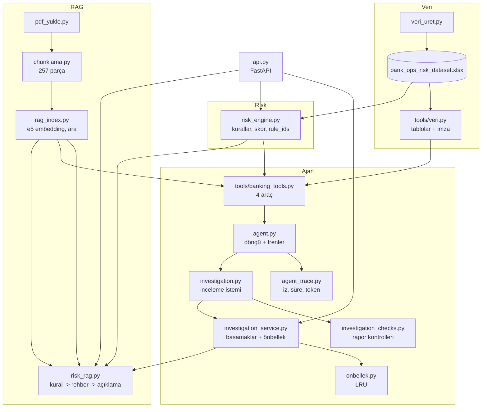

# Mimari

Bu belge sistemin **şu an nasıl çalıştığını**, hangi dosyanın hangi katmanda durduğunu ve neden öyle yaptığımı anlatır. Kurulum ve kullanım için [`README.md`](../README.md). Yapılmayanlar ve sınırlılıklar README'nin "Sınırlılıklar" bölümünde.

## Genel akış

`/predict-risk` yalnızca risk motoruna dokunur, Claude ya da rehber yüklenmeden çalışır.

## Modül haritası

| Katman | Dosya | Görevi |
|---|---|---|
| Veri | `veri_uret.py` | Sentetik veri üretir (600 müşteri, hesaplar, 120.000 işlem, `seed=42`). |
| Veri | `tools/veri.py` | Excel tablolarını bir kez yükler, veri imzası (içerik parmak izi) üretir. |
| Risk | `risk_engine.py` | Dört kural, skor (en çok 100), etiket (eşik 50), `reasons` ve sabit `rule_ids`. |
| RAG | `pdf_yukle.py` | Rehber PDF'ini sayfa sayfa okur ve temizler. |
| RAG | `chunklama.py` | Metni 20-50 kelimelik (en çok 75) parçalara böler, kayıt kodlarını (`SK-..`, `T-001-..`) ve başlıkları yakalar. İçindekiler sayfaları atlanır. |
| RAG | `rag_index.py` | `intfloat/multilingual-e5-large` ile embedding, `.npz` indeks, `ara()` (kosinüs benzerliği). Vektör deposunu değiştirmek için tek nokta. |
| RAG | `rag_cevap.py` | Soru → arama → atıflı cevap; rehberde yoksa "bulamadım". |
| RAG | `risk_rag.py` | Tetiklenen kural kimlikleri → ilgili rehber parçaları → Claude açıklaması. Kural tetiklenmediyse Claude çağrılmaz. |
| Araç | `tools/banking_tools.py` | Ajanın dört aracı: `get_customer_info`, `get_transaction_history`, `get_risk_score`, `search_risk_policy`. Şemalar ve çalıştırıcı. Hata cevabı `{"error": ...}` biçimindedir. |
| Ajan | `tool_calling.py` | Tek turlu araç çağırma, ortak sabitler (model, token sınırı). |
| Ajan | `agent.py` | Döngü: Claude karar verir → Python aracı çalıştırır → sonuç Claude'a döner. Dört fren (aşağıda). |
| Ajan | `agent_trace.py` | Her adımın aracı, argümanı, token ve süresi; JSON iz dosyaları. |
| Ajan | `investigation.py` | İnceleme sistem istemi (5 başlık, hüküm yasağı) ve `incele()`. |
| Ajan | `investigation_checks.py` | Rapor için kaba otomatik kontroller (uydurma işlem, geçersiz atıf, hüküm dili, eksik başlık). |
| Ajan | `investigation_service.py` | `/investigate` iş mantığı: basamak merdiveni, önbellek, uyarılar. |
| Ajan | `onbellek.py` | Eşzamanlı kullanıma uygun LRU önbellek. |
| API | `api.py` | FastAPI uç noktaları, doğrulama modelleri, açılışta ısıtma. |
| Demo | `embedding_demo.py` | Embedding benzerliği öğrenme demosu, sistemin parçası değil. |

## Tasarım kararları ve nedenleri

**Deterministik iş araçta kalır.** Skor hesabı, müşteri verisi ve işlem sıralaması Python'da. Claude hesaplama yapmaz, sadece hangi aracı hangi argümanla çağıracağını söyler ve sonuçları yazıya döker. Bu yüzden `/investigate` cevabındaki "en riskli 3 işlem" Claude'dan değil doğrudan veri katmanından gelir: Claude çökse de doğru.

**Risk motoru kural tabanlı ve açıklanabilir.** Her kural sabit bir kimlik taşır (`FAILED_TX`, `RISKY_CHANNEL`, `INTERNATIONAL`, `AMOUNT_ANOMALY`). Kimlik neden metninden ayrıdır çünkü metin `z=3.5` gibi sayılar içerir ve önbellek/politika eşleştirmesi için kararlı bir anahtar gerekir. Tek bir kural eşiği (50) geçirmez, en az iki sinyal birleşmeli. Eşik ve puanlar benim varsayımım, veriden öğrenilmedi.

**Vektör deposu: numpy + `.npz`.** Chroma/FAISS planda vardı ama atlandı. Rehber 257 parça, tam tarama anlık. `ara()` tek değişim noktası, yani sonra eklenebilir. Chroma/FAISS ile karşılaştırma yapılmadığı için "daha iyi/aynı/daha kötü" iddiası yok. Embedding için üç model tanımlı (MiniLM, mpnet, e5), varsayılan e5. `tests/arama_testi.py` aramayı 13 soruda ölçer; e5 ile doğru parça çoğunlukla ilk sırada çıkıyor (medyan sıra 1, en kötü 4).

**Chunklama rehberin yapısına göre.** Rehber, kayıt kodlu satırlardan (`SK-..`, `T-001-..`) ve numaralı başlıklardan oluşuyor. Parça sınırları buna göre belirlenir, cümle ortasında kesilmez (50 kelime hedef, 75'e kadar esner). İçindekiler/sürüm tablosu sayfaları (1-4) arama gürültüsü yaptığı için atlanır. Form tabloları hâlâ gürültülü parçalar üretebiliyor, bilinen bir zayıflık.

**Kural–politika eşleşmesi kaba.** Rehber `RISKY_CHANNEL` gibi kuralların tanımını içermiyor. `risk_rag.KURAL_SORGULARI` her kural için rehberdeki yakın bir ifadeyi arar (ör. "İnternet ve mobil kanaldan yapılan işlemler"). Bu bir yaklaşıklık. Ajan ise kendi arama sorgusunu yazar, bu yüzden bulduğu kanıt çalıştırmadan çalıştırmaya değişir. Deterministik sorgulara geçmek denenmedi (README, Gelecek çalışma).

**"Bulamadım" koruması.** RAG sistem istemi sadece verilen kaynaklara dayanmayı, atıf yapmayı ve rehberde yoksa `Rehberde bu bilgiyi bulamadım.` demeyi ister. Cevapsız 9 soruda (3+3+3) doğru reddetme 9/9, ama bu küçük bir küme.

**Düşünme (thinking) tokenları.** Kullanılan modelde düşünme tokenleri `max_tokens` bütçesinden harcanıyor. İlk denemede 1000 token yetmeyip cevap boş çıktı. Bu yüzden `MAKS_TOKEN = 4000`. Maliyet tarafında çıktı tokenlerine düşünme dahil.

**Ajan döngüsü ve frenler.** Dört bağımsız fren, hangisi önce dolarsa döngü durur ve nedeni `bitis` alanına yazılır:

| Fren | Varsayılan | `bitis` |
|---|---|---|
| Adım sayısı (`max_steps`) | 5 (inceleme: 6) | `adim_siniri` |
| Toplam süre (`sure_siniri_sn`) | yalnız `/investigate`: 120 sn | `sure_siniri` |
| Token bütçesi | 30.000 | `token_siniri` |
| Model kendi durdu | - | `tamamlandi`, aksi halde `durdu:<neden>` |

Sınırda gelen araç istekleri **çalıştırılmaz**, yalnızca kaydedilir. Kontrol sırası: adım, süre, token. Sınırda kesilen bir inceleme "tamamlandı" sayılmaz ve rapor olarak kullanılmaz.

**Ajan bir PoC.** Rapor başlıkları sabit, "karar analistindir" kuralı sistem istemine yazıldı, ajan hüküm cümlesi kurmamalı (`hukum_yok` kontrolü bunu kaba şekilde izler). Otomatik kontroller yalnızca ipucu: uydurma işlem numarası ve geçersiz sayfa atfı yakalanır, ama örneğin ülke kodu ya da tutar gibi sayısal iddialar denetlenmez.

**Zarif bozulma (`/investigate`).** Basamaklar, yukarıdan aşağıya:

0. Veri katmanı (Claude yok). Müşteri yoksa 404. Veri katmanı bozuksa 500: çekirdek bozukken sessizce "boş" cevap dönmek istemedim.
1. Ajan raporu (`rapor_kaynagi: ajan`), sadece `bitis=tamamlandi` ise.
2. En riskli işlemin kural tabanlı Claude açıklaması (`aciklama`).
3. Yalnız veri (`yok`).

Müşteri varsa yanıt her zaman 200. Otomatik kontrolleri geçmeyen bir ajan raporu yine döner ama `uyarilar` içinde hangi kontrolün kaldığı yazar (rapor gizlenmez).

**Önbellek.** İki bellek içi LRU:

| Önbellek | Anahtar | Ne saklanır |
|---|---|---|
| Rapor (128) | (müşteri, **veri imzası**, istem kimliği) | Tamamlanan ajan raporu, kontroller, iz özeti |
| Açıklama (256) | (etiket, skor, `rule_ids`, **neden metinleri**) | Claude'un ürettiği açıklama |

Anahtarda veri imzası var: Excel değişirse eski rapor kullanılmaz. Açıklama anahtarına `reasons` metinleri de girer, çünkü kural kimlikleri aynı olsa da `z` değeri farklı olabilir ve yanlış sayıyı başka işlemin açıklamasında göstermek istemedim. Hatalı/yarım sonuçlar ve Claude'un üretmediği sabit metinler saklanmaz. Değerler kopyalanarak verilir/alınır. Aynı anda gelen iki aynı istek ikisi de hesaplanır (tek-uçuş yok), süreç yeniden başlayınca önbellek boşalır. Önceki plan sadece `etiket + sıralı rule_ids` anahtarı öneriyordu, bunu bilerek genişlettim.

**Isıtma.** Açılışta Excel ve e5 yüklenir (birkaç sn). Aksi halde ilk rehber aramasında 6,5-10 sn bekleniyor. Isıtma başarısız olsa sunucu açılır, model ilk gerçek istekte yüklenir. `RAG_ISITMA=0` ile kapatılır.

**Girdi doğrulama.** `customer_id` yalnızca ≥1 tam sayı kabul eder: `"1"`, `1.5`, `true`, `0`, negatifler 422 döner (Pydantic `StrictInt`). Böylece `true` sessizce 1 olarak yorumlanmaz.

**Import yapısı.** Modüller düz adlarla import eder (`from risk_engine import ...`), bu yüzden sunucu `--app-dir src` ile başlar. `tools` ile `api` birbirini yalnızca fonksiyon içinde (tembel) import eder, böylece `/predict-risk` Claude kütüphanesi yüklenmeden çalışır ve döngüsel import oluşmaz. Alt paketlere (`src/rag/`, `src/agent/` gibi) bölmeyi **bilerek yapmadım**: çalışan ve test edilmiş yapıyı kırma riski, kazandığı görünümden büyüktü. Bu belgedeki modül haritası aynı işi görüyor.

## Değerlendirme dürüstlüğü

| Küme | Durum |
|---|---|
| Ayar seti (7 soru) | Ayar sırasında defalarca görüldü, skor şişik |
| Held-out (15 soru) | Ayar yapılmadan yazıldı; sonuç görüldükten sonra değiştirilmedi |
| Taze (11 soru) | Gün 13'te yazıldı, hiç ayar görmedi, en dürüst ölçü |

Sayılar README'de. Üçü de küçük. Held-out'taki tek hata (#17, "birden çok kişi için kaç form") arama hatası: beklenen bilgi çekilen parçalarda yoktu (`ARAMA_KACTI`), yani sorun arama/chunklamadaydı, cevap üretiminde değil.

## Test stratejisi

Üç katman:
1. **Birim ve entegrasyon, çevrimdışı:** sahte Claude + sahte rehber vektörü + **gerçek** araçlar ve gerçek veri. Hızlı, ücretsiz, her değişiklikten sonra çalıştırılır. Test edilen davranışın bozulabildiği, zayıf testleri ise kasıtlı bozulan kod (mutasyon) denemeleriyle ayıkladım.
2. **Gerçek Claude testleri:** küçük maliyetli (`held_out_testi`, `rag_cevap_testi`, `inceleme_degerlendirme`).
3. **Canlı deneme:** sunucu + `Invoke-WebRequest` ile elle (README, Demolar).

Sahte istemcili testler Claude'un gerçek davranışını ölçmez, yalnız bizim kodumuzun doğru tepki verdiğini ölçer.
